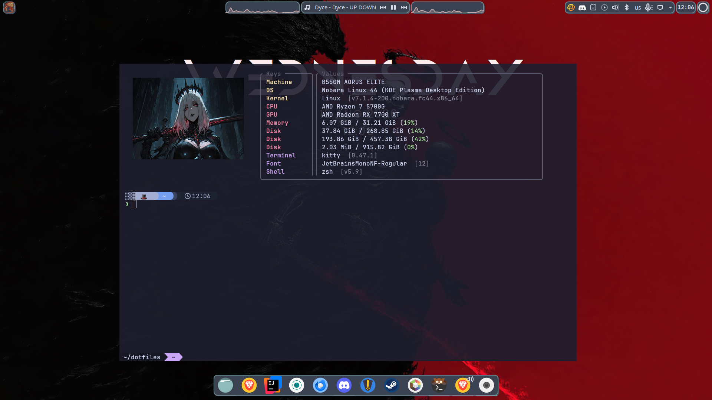

# 🐧 My Dotfiles

A collection of my personal configuration files optimized for **Nobara Linux**, managed modularly with **GNU Stow**.



## 🛠️ Included Tools & Ecosystem

*   **Kitty**: My primary terminal simulator, configured with the Catppuccin Mocha theme, custom opacity toggles, and high-res image rendering protocol.
*   **Helix**: A modern, modal text editor utilized as my main global core editor with customized keymaps.
*   **Zsh (+ Zinit & Starship)**: Fully customized shell featuring Zinit for rapid plugin management (auto-suggestions, tab completions) and a sleek Starship prompt.
*   **Fastfetch**: Highly tailored system information display, stripped down to a minimal box layout layout next to custom artwork.
*   **Git**: Structured global workflow configurations using linear rebase pulls and Helix integration.

---

## 📦 System Dependencies

Before deploying these dotfiles on Nobara (or any Fedora-based system), make sure to install the required tools and fonts:

### 1. Core Packages & Utilities
```bash
sudo dnf install stow chafa kitty helix zsh -y
```

__(Note: ```chafa``` is strictly required to enable fastfetch to parse and render high-quality images directly inside the Kitty terminal).__


### 2. Typography: JetBrainsMono Nerd Font
Essential for rendering the custom glyphs, icons, and branch symbols used in Starship, Helix, and Fastfetch.

```bash
# Create local fonts directory
mkdir -p ~/.local/share/fonts

# Download and extract JetBrainsMono Nerd Font
cd /tmp
curl -OL [https://github.com/ryanoasis/nerd-fonts/releases/latest/download/JetBrainsMono.tar.xz](https://github.com/ryanoasis/nerd-fonts/releases/latest/download/JetBrainsMono.tar.xz)
tar -xvf JetBrainsMono.tar.xz -C ~/.local/share/fonts

# Refresh system font cache
fc-cache -fv
```
## 🚀 Installation & Deployment
### 1. Clone the repository via SSH
```bash
git clone git@github.com:DededeOQ/dotfiles.git ~/dotfiles
```
